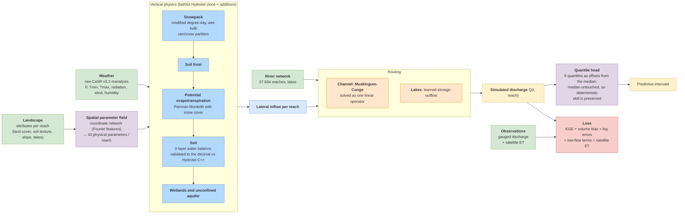
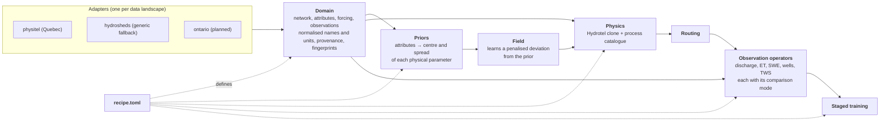

# Meandre: Model Architecture

Updated 2026-10-26. Part 1 describes the provincial model frozen in October 2026, as it runs today. Part 2 describes the target architecture decided on 2026-10-26, which reorganises the same model around a domain contract so that it can be driven from a single recipe and applied outside Quebec. Each step of Part 2 states what exists, what changes and how it is verified.

## Part 1: the model as it runs

### One domain for the province

The 15 PHYSITEL territories are loaded as a single domain of 27 834 reaches and trained together. A single parameter field covers the province, so neighbouring reaches on either side of a territorial boundary cannot receive unrelated parameters. Territories survive only as a reporting unit. On an 8 GB GPU the province fits by computing the gradient in segments (`[compute] gradient_segments`) and by splitting each routing level into independent basins (`[compute] operator_block`).

### Spatial parameter field (`meandre/spatial/field_network.py`)

A small MLP maps longitude, latitude and landscape attributes to the 43 physical parameters of each reach. Coordinates go through Fourier positional encoding after an isotropic map projection; raw degrees made the field anisotropic and collapsed it to near-uniform values. Sigmoid or softplus bounds keep each parameter in its physical range.

* Saturated conductivity of each soil layer is bounded per reach within a factor of 3 of the value given by the mapped soil texture (SIIGSOL, PHYSITEL as fallback). The field adjusts conductivity but cannot invert the pedology.
* Field capacity is derived from the retention curve at -33 kPa instead of being learned beside it.
* A prior pulls the mean of each parameter toward literature defaults (Rawls soil hydraulics, Hock melt rates, FAO-56) and leaves the spatial variation free.
* Per-reach latent codes exist in the code but are off in the provincial model, because they do not transfer to ungauged reaches.

`init_from_literature()` biases the output layer so that training starts from physically plausible values.

Known limitation (measured 2026-10-25): in the frozen model, porosity sits at its upper bound on 66 to 81 % of reaches and the thicknesses of layers 2 and 3 at their lower bound on 84 to 89 %. A saturated sigmoid has no gradient, so the field cannot leave a bound, and moving a bound remaps every reach at once. Two declared settings mitigate this without changing frozen results: a gradient floor on selected outputs (`[spatial] gradient_floor`) and an extension below the lower bound that preserves the starting values (`[spatial] extend_below`). The structural fix is Part 2, step 3.

### Vertical physics (`meandre/vertical/hydrotel_column.py` + `meandre/hydrotel/`)

The column is a line-by-line port of the Hydrotel C++ source, version 4.3.6. Each ported piece was validated against the compiled binary on every computational unit before use. The 3-layer soil balance and the Linacre evapotranspiration match the C++ to the decimal over thousands of units and several years. Where meandre differs from Hydrotel, the difference is a documented option.

* Snowpack: modified degree-day melt. Rain and snow are partitioned at a wet-bulb temperature of -0.8 °C, and melt rates follow a seasonal amplitude.
* Soil frost: Rankinen scheme, with snow insulation. The frost gate on infiltration has a declared amplitude (`[column] frozen_gate_amplitude`, 1 reproduces Hydrotel).
* Potential evapotranspiration: Penman-Monteith, accounting for snow cover; transpiration is reduced in cold soil. Canopy phenology follows day length and degree-days; the agricultural class may receive its own calendar (`[phenology] params_agri`).
* Soil: three layers with the BV3C scheme, solved by a linearly implicit step that keeps the gradient bounded. Conductivity is corrected for water viscosity with the Vogel law, referenced to 5 °C. A share (θ1/θs1)^8 of the inflow runs off as saturation excess. Soil processes are declared per layer in the TOML `[soil]` section, from a catalogue with Raven's names.
* Groundwater: an unconfined aquifer whose state is the water-table depth, with a Dupuit-Boussinesq outflow (exponent 2) and extraction from the saturated zone.
* Open water evaporates the deficit between potential evaporation and the day's inflow, so lakes outside the routing network also evaporate in dry weather.
* The wetland exchange conserves mass. Hydrotel's formulation, which loses about 1 % of precipitation, remains available as an option.

### Routing (`meandre/routing/`)

Hydrotel routes water with a kinematic wave over the hillslope and a modified kinematic wave in the channel. meandre uses Muskingum-Cunge in the channel, with travel time K and weighting x learned per reach (K bounded from 4 to 48 hours, x from 0.01 to 0.49). Once K and x are fixed, routing is linear in the inflows, so the whole simulation is solved as one triangular linear system instead of a day-by-day loop. This gives identical results and exact gradients.

Lakes have a learned storage-outflow relation; removing them costs about 0.2 KGE on lake-rich basins. Water withdrawals from the io-eau inventory are injected per reach.

### Probabilistic head (`meandre/utils/quantile_head.py`)

Six quantiles, from 5 % to 95 %, are predicted as multiplicative offsets from the simulated discharge, which remains the median. The head is trained with the pinball loss on a frozen backbone (`ETL_QUANTILE=1`). The deterministic skill is preserved by construction, and only the interval widths are learned. Calibration is judged on 2022-2024 by the share of observations below each quantile and the coverage of the 50, 80 and 90 % intervals.

### Losses (`meandre/training/loss.py`)

The provincial model minimises, per station and on the continuous series:

* KGE (weight 1), volume bias (0.5), squared error on log flows (0.3);
* a low-flow term (1) and the low end of the flow duration curve (1);
* day-to-day flow variations (0.5);
* MOD16 evapotranspiration, centred per reach and down-weighted under snow (0.4);
* the parameter prior described above.

Terms that compare statistics use the absolute deviation, never the square, so that small errors still produce a first-order gradient.

### Training (`meandre/training/trainer.py`)

Training runs on 2001-2018 and selects on 2019-2021. Evaluation uses 2022-2024, never seen in training or selection. The state is detached every 90-day chunk, with one optimisation step per chunk, at a constant learning rate of 2e-4 without warm-up. Training stops after eight epochs without improvement on the validation loss. On two trainings from scratch, the last epoch did better than the validation-selected one on 2022-2024, so the frozen model uses the last epoch. A fine-tuning restarted from the same checkpoint is deterministic: the seed changes nothing.

### Configuration

A model is defined by a TOML file. Every setting of the package and the pilot is declared once in `meandre/utils/settings.py` (95 settings on 2026-10-26): its key in the file, a legacy environment alias, a default and a role. An alias set in the environment takes precedence over the file, and the file over the default; an unknown key in a declared section stops the run. The frozen provincial model is `.runs/quebec/config/modele-provincial-2026-10.toml`. Every checkpoint writes the configuration that produced it to `<name>.recette.toml`, readable without torch. The `[recette]` section and the `.recette.toml` name are legacy; Part 2 renames them to `recipe`.

### Why the soil is learned, not borrowed from Hydrotel

The operational reference is an ensemble of six calibrations of the same Hydrotel physics, whose regional rankings are mutually inconsistent. Their soil calibration compensates the biases of Hydrotel's own kriged weather. On the same code with zero training, it gives a KGE of 0.78 with that weather and 0.59 with a CaSR forcing on the Outaouais territory. meandre is forced by raw CaSR, so it learns soil and evapotranspiration on that forcing instead of importing a calibration made for another one.

## Part 2: target architecture (decided 2026-10-26)

### Why

The model is hard to drive because four things that should be separate are mixed: knowledge of the world (network, attributes, forcing, observations), physics, learning, and launching. The pilot `.runs/quebec/etl_run.py` is 2 400 lines and reads 95 settings; the loaders in `meandre/data` know about PHYSITEL, Hydrotel calibrations and Quebec territories; the field encodes bounds that are in fact calibration choices. The question "what is this parameter and why" has no single place where it is answered. Three consequences were measured in October 2026:

* Under-identification. The field produces 43 parameters per reach; discharge identifies a few combinations, and ten fields have zero sensitivity. Any physical correction imposed on one process is undone by compensation in another (winter precipitation excess compensated by an empty summer; an agricultural phenology calendar, right against MOD16, erased by fine-tuning; a surface permeability divided by three, cancelled by the field).
* Hidden calibration in bounds. Two thirds of the reaches sit on a bound without gradient, and a bound change remaps every reach.
* Fragile data chain. The attribute table of the field differed between two machines for six weeks (distance to outlet wrong on one of them) without any check reporting it.

### Principle

The model knows neither PHYSITEL, nor Quebec, nor a machine. It knows a domain, defined by a contract, and a recipe, which says everything else.

### Layers

1. Domain (`meandre/domain/`). The river network (reaches, topology, lengths, slopes, areas, lakes), per-reach attributes under normalised names and units, the forcing series, the observations. Each piece carries its provenance (source, version, date) and a fingerprint of the file it came from. Validation rejects a domain whose network is not a forest, whose attributes have missing units, or whose fingerprints differ from the recipe's. This is the only object the physics and the learning see.
2. Adapters (`meandre/adapters/<landscape>/`). Each adapter turns its sources into a domain store. `physitel` reads the Quebec platforms and everything specific to Quebec moves with it: PHYSITEL readers, Hydrotel calibration loaders, NEISIM, RSESQ wells, io-eau withdrawals, SIIGSOL, SIGEOM, the ecoforestry map, the notion of territory. `hydrosheds` builds a domain from HydroSHEDS, HydroRIVERS and HydroLAKES, available everywhere, as the generic fallback. The adapter is the only place where a data landscape is named.
3. Priors (`meandre/priors/`). A declared catalogue turns attributes into a central value and a spread for each physical parameter: pedotransfer on texture for porosity, field capacity, wilting point and conductivity; deposit thickness or depth to bedrock for layer thicknesses; drainage class for the percolation ceiling; land cover and MODIS for crop coefficient, interception and phenology; recession signatures of gauged discharge for the groundwater exponent and time constants, transferred to reaches. Computed once per domain and stored with it. Parameters that no observation identifies are fixed at their prior.
4. Physics (`meandre/hydrotel/`, `meandre/vertical/`). Unchanged. The soil process catalogue stays declarative.
5. Field (`meandre/field/`, today `meandre/spatial/`). Learns a deviation from the prior for the parameters that discharge and the auxiliary observations identify. No hard sigmoid bounds: the penalty grows with the deviation divided by the prior's spread, so a bound never captures a value silently, and a prior change does not remap the field.
6. Observation operators (`meandre/observations/`). Each observable is declared with how the model produces it, its comparison mode (level, centred, shape), its weight and its source. Discharge is one observable among others.
7. Staged training (`meandre/training/`). Each process is first fitted against its own observation (snow against SWE products, evapotranspiration against MOD16, the water table against wells), then all against discharge. A mechanism anchored this way is not undone silently.
8. Entry point. `meandre run recipe.toml`, `meandre eval`, `meandre probe`. The recipe names the domain, the priors, the physics, the observables, the training and the evaluation. The environment carries only machine paths (`MEANDRE_DATA` and relatives). Every run writes `recipe.toml` next to its checkpoint, with the fingerprints of its inputs; a later run on different inputs is refused unless told otherwise.

### What does not change

The validated Hydrotel physics, the operator routing, the positional encoding of the field, the declared settings and the loss terms. The envelope is rebuilt around the engine. Each step is verified by a forward pass identical to the frozen provincial model before the next step starts, with the full test suite.

### The river network

PHYSITEL is a strength in Quebec: validated topology, lakes, wetlands. Outside Quebec it does not exist. HydroSHEDS, HydroRIVERS and HydroLAKES exist everywhere and are coarser; they handle the lakes of the Shield less well. No network builder from a digital elevation model is planned: it is a project of its own. The domain contract accepts several network sources, and the `hydrosheds` adapter serves as the fallback everywhere.

### Steps and acceptance criteria

| step | what changes | accepted when |
|---|---|---|
| 1. Domain contract | `meandre/domain/` defined; the Quebec DuckDB bases are produced through a `physitel` adapter; the `[recette]` section, `meandre/utils/recette.py` and `.recette.toml` become `recipe` | forward pass of the frozen model identical on one territory; tests pass |
| 2. Quebec out of the core | Quebec-specific loaders, calibrations and territories move to `meandre/adapters/physitel/`; `meandre/data` keeps only generic readers | no module of the core imports a Quebec source; identical forward pass |
| 3. Priors and field in deviation | priors catalogue computed from attributes; field learns a penalised deviation; hard bounds removed | identical forward pass at zero deviation from the frozen parameters; then a fine-tuning on Montérégie, Saint-Laurent sud-ouest and Outaouais, judged on the loss |
| 4. Observables and staged training | observables declared in the recipe with their operator and mode; training by stages | the provincial recipe reproduces the frozen model's loss terms; one staged training compared with the current one on the same three territories |
| 5. Generality | an `ontario` or `hydrosheds` domain built from open sources (HYDAT, CaSR, HydroSHEDS, Soil Landscapes of Canada, NALCMS, depth to bedrock, MOD16, GRACE, CanSWE) | the recipe runs unchanged on that domain and produces a per-station table |

### Open decisions

* The exact schema of the domain store (DuckDB for tables and zarr for series are the current choices, and can stay).
* Which parameters are centred first: porosity, field capacity, wilting point and the layer thicknesses, where the data exist, then conductivity.
* Whether the hillslope unit hydrograph and the Hydrotel regional anchors, unused by the provincial model, are kept in the `physitel` adapter or retired.

## Retired modules (kept for checkpoint compatibility, inactive)

* GRU temporal encoder, residual corrector, parameter noise, Concrete Dropout, heteroscedastic sigma head, mixture head, contextual quantile head, travel-time attention: removed from the package on 2026-10-23; their checkpoint keys are filtered at load time.
* Hillslope unit hydrograph and regional anchors on Hydrotel calibrations, available but unused in the provincial model.
