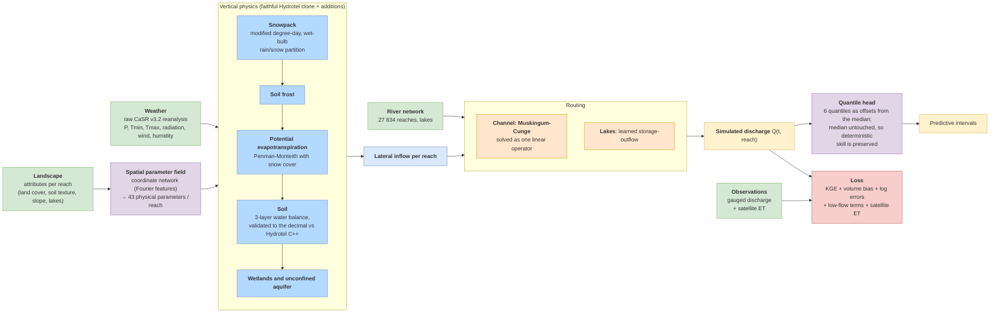

# Meandre: Model Architecture

Updated 2026-10-18. Describes the provincial model frozen in October 2026. It combines one parameter field for the whole of Quebec, a faithful clone of the Hydrotel vertical physics with documented additions, channel routing, and a quantile head. Retired modules are listed at the end for checkpoint compatibility.

## Overview

## One domain for the province

The 15 PHYSITEL territories are loaded as a single domain of 27 834 reaches and trained together. A single parameter field covers the province, so neighbouring reaches on either side of a territorial boundary cannot receive unrelated parameters. Territories survive only as a reporting unit. On an 8 GB GPU the province fits by computing the gradient in segments (`MEANDRE_SEGMENT_GRADIENT=10`) and by splitting each routing level into independent basins (`MEANDRE_OPERATOR_BLOCK`).

## Spatial parameter field (`meandre/spatial/field_network.py`)

A small MLP maps longitude, latitude and landscape attributes to the 43 physical parameters of each reach. Coordinates go through Fourier positional encoding after an isotropic map projection; raw degrees made the field anisotropic and collapsed it to near-uniform values. Sigmoid or softplus bounds keep each parameter in its physical range.

* Saturated conductivity of each soil layer is bounded per reach within a factor of 3 of the value given by the mapped soil texture (SIIGSOL, PHYSITEL as fallback). The field adjusts conductivity but cannot invert the pedology.
* Field capacity is derived from the retention curve at -33 kPa instead of being learned beside it.
* A prior pulls the mean of each parameter toward literature defaults (Rawls soil hydraulics, Hock melt rates, FAO-56) and leaves the spatial variation free.
* Per-reach latent codes exist in the code but are off in the provincial model, because they do not transfer to ungauged reaches.

`init_from_literature()` biases the output layer so that training starts from physically plausible values.

## Vertical physics (`meandre/vertical/hydrotel_column.py` + `hydrotel_clone/`)

The column is a line-by-line port of the Hydrotel C++ source, version 4.3.6. Each ported piece was validated against the compiled binary on every computational unit before use. The 3-layer soil balance and the Linacre evapotranspiration match the C++ to the decimal over thousands of units and several years. Where meandre differs from Hydrotel, the difference is a documented option.

* Snowpack: modified degree-day melt. Rain and snow are partitioned at a wet-bulb temperature of -0.8 °C, and melt rates follow a seasonal amplitude.
* Soil frost: Rankinen scheme, with snow insulation.
* Potential evapotranspiration: Penman-Monteith, accounting for snow cover; transpiration is reduced in cold soil.
* Soil: three layers with the BV3C scheme, solved by a linearly implicit step that keeps the gradient bounded. Conductivity is corrected for water viscosity with the Vogel law, referenced to 5 °C (factor 0.86 at 0 °C, 1.16 at 10 °C). A share (θ1/θs1)^8 of the inflow runs off as saturation excess. Soil processes can also be declared per layer in the TOML `[soil]` section.
* Groundwater: an unconfined aquifer whose state is the water-table depth, with a Dupuit-Boussinesq outflow (exponent 2) and extraction from the saturated zone. Hydrotel's aquifer loses recharge irreversibly.
* Open water evaporates the deficit between potential evaporation and the day's inflow, so lakes outside the routing network also evaporate in dry weather.
* The wetland exchange conserves mass. Hydrotel's formulation, which loses about 1 % of precipitation, remains available with `ETL_MH_FIDELE=1`.

## Routing (`meandre/routing/`)

Hydrotel routes water with a kinematic wave over the hillslope and a modified kinematic wave in the channel. meandre uses Muskingum-Cunge in the channel, with travel time K and weighting x learned per reach (K bounded from 4 to 48 hours, x from 0.01 to 0.49). Once K and x are fixed, routing is linear in the inflows, so the whole simulation is solved as one triangular linear system instead of a day-by-day loop. This gives identical results and exact gradients.

Lakes have a learned storage-outflow relation; removing them costs about 0.2 KGE on lake-rich basins. Water withdrawals from the io-eau inventory are injected per reach.

## Probabilistic head (`meandre/utils/quantile_head.py`)

Six quantiles, from 5 % to 95 %, are predicted as multiplicative offsets from the simulated discharge, which remains the median. The head is trained with the pinball loss on a frozen backbone (`ETL_QUANTILE=1`). The deterministic skill is preserved by construction, and only the interval widths are learned. Calibration is judged on 2022-2024 by the share of observations below each quantile and the coverage of the 50, 80 and 90 % intervals.

## Losses (`meandre/training/loss.py`)

The provincial model minimises, per station and on the continuous series:

* KGE (weight 1), volume bias (0.5), squared error on log flows (0.3);
* a low-flow term (1) and the low end of the flow duration curve (1);
* day-to-day flow variations (0.5);
* MOD16 evapotranspiration, centred per reach and down-weighted under snow (0.4);
* the parameter prior described above.

Terms that compare statistics use the absolute deviation, never the square, so that small errors still produce a first-order gradient.

## Training (`meandre/training/trainer.py`)

Training runs on 2001-2018 and selects on 2019-2021. Evaluation uses 2022-2024, never seen in training or selection. The state is detached every 90-day chunk, with one optimisation step per chunk, at a constant learning rate of 2e-4 without warm-up. Training stops after eight epochs without improvement on the validation loss. On two trainings from scratch, the last epoch did better than the validation-selected one on 2022-2024, so the frozen model uses the last epoch.

## Configuration

A model is defined by a TOML file whose `[recette]` section sets the environment read by the pilot (`meandre/utils/recette.py`). The frozen provincial model is `.runs/quebec/config/modele-provincial-2026-10.toml`. Every checkpoint writes the configuration that produced it to `<name>.recette.toml`, readable without torch. The weather forcing is never set in a file and must be given at launch (`JOINT_FX_SUFFIX=-casr-brut`).

## Why the soil is learned, not borrowed from Hydrotel

The operational reference is an ensemble of six calibrations of the same Hydrotel physics, whose regional rankings are mutually inconsistent. Their soil calibration compensates the biases of Hydrotel's own kriged weather. On the same code with zero training, it gives a KGE of 0.78 with that weather and 0.59 with a CaSR forcing on the Outaouais territory. meandre is forced by raw CaSR, so it learns soil and evapotranspiration on that forcing instead of importing a calibration made for another one.

## Retired modules (kept for checkpoint compatibility, inactive)

* GRU temporal encoder (inactive on the Quebec line).
* Residual corrector (disabled).
* Earlier uncertainty stacks (parameter noise, Concrete Dropout, a heteroscedastic sigma head), superseded by the quantile head.
* Hillslope unit hydrograph and regional anchors on Hydrotel calibrations, available but unused in the provincial model.
